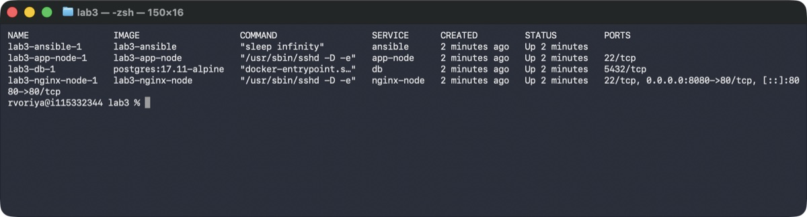
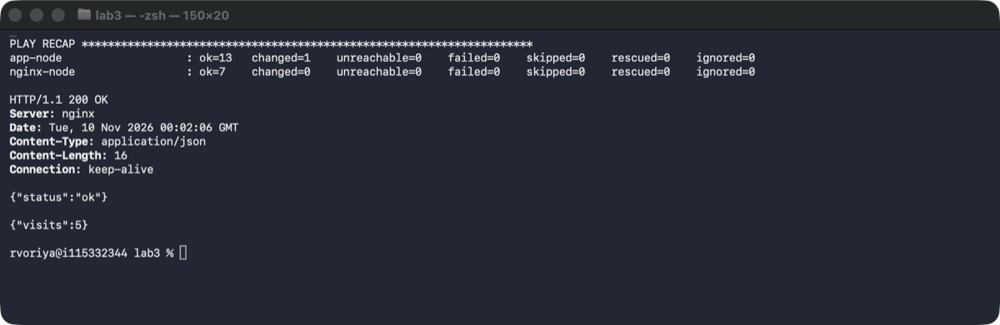

# Лаба 3 — Ansible

Приложение из второй лабы, исходники в `app/`.

Контейнеры: `ansible` (мастер), `nginx-node` и `app-node` (чистые Debian), `db` (PostgreSQL).

Роли: `app` деплоит приложение и запускает его через `start.sh`, `nginx` ставит nginx как прокси на `app-node`.

## Запуск

```
cd lab3
cp .env.example .env
mkdir keys && ssh-keygen -t ed25519 -N "" -f keys/id_ed25519
docker compose up -d --build
docker compose exec ansible ansible-playbook site.yml
```

## Проверка

```
docker compose ps
curl localhost:8080/health
curl localhost:8080/
```

## Скрины




